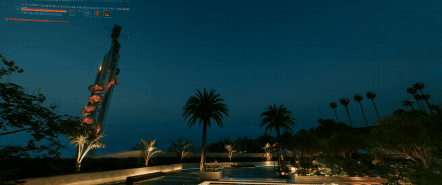
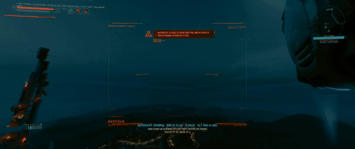
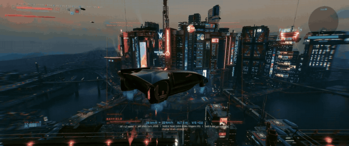
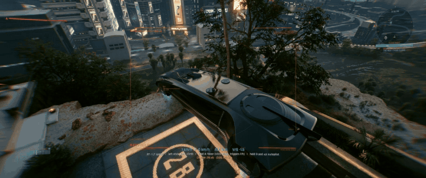
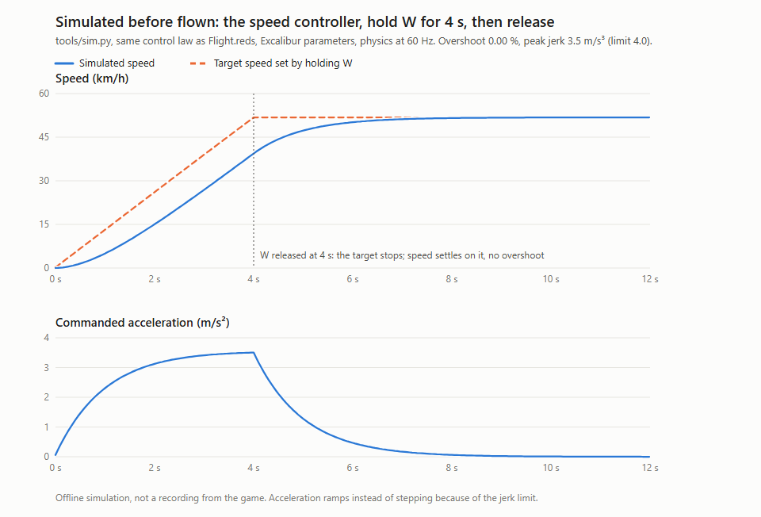

# Cyberslop AV Flight

Charter and fly aircraft in Cyberpunk 2077: a fly-by-wire flight controller, paid charter and an autopilot to the tracked map pin. Single-player only.
Version 1.0.0 build 16 | For game version 2.5 | Status: builds 7, 8, 9, 11 and 13 flown in game; builds 12 and 14 to 16 compile and are not yet flown; installing from this repository has not been tested on a clean setup

> This is an unofficial fan work and is not approved/endorsed by CD PROJEKT RED. No game files are included.

<p>


</p>
<p>


</p>
<p>

</p>

**This repository is source, not a ready-to-install package.** The mod needs the flight-physics DLL and aircraft archive of another author's mod, which you download yourself, and one data file that you generate from that download with a script included here. See Install.

## The problem

Two existing flight mods were installed, 17 MB and 77 MB. One brought 600 KB of Lua that hooked the player's input and ran a pathfinder; the other made every car fly. Neither gave a simple way to call an aircraft, fly it predictably and get out again, and both cost performance when nothing was flying.

## What I built

A flight mod in redscript, about 4,500 lines in nine files (not counting the generated data files), that runs only while an aircraft exists or you pilot one. It wraps four game functions: the player's mount and unmount events and two exit-direction checks. It reuses the native physics DLL and the aircraft models of one of those mods and replaces everything else. It changes: how six aircraft (four AVs, two helicopters) and one quest helicopter are controlled while you sit in the pilot seat, and it adds a charter service with a bill.

## How it works

**Flight control.** Every control commands a speed, never a raw push. The throttle sets a target speed and the controller accelerates toward it within the aircraft's limits, with jerk limited to 4 m/s3. Sideways slip is removed. Climb and descent command a vertical speed; let go and it holds altitude. Turn rate at speed is limited to a coordinated turn of about 30 degrees of bank. Below 10 m the descent slows by itself, and on touchdown the aircraft goes back to the game's own physics.

**Charter.** On foot, hold the call key: a quote appears (dispatch fee plus ferry fuel, with an arrival time). Hold again to pay. The aircraft flies in from the nearest of 111 depots and lands near you. The bill covers rental time and fuel burned.

**Autopilot.** Hold the autopilot key with a map pin tracked. It reads a building height map, climbs above the highest thing on the line, cruises and lands on a flat spot at the pin.

**Hover hold.** If the setting allows getting out in the air, the aircraft brakes, holds its altitude and keeps its engines running; tap the call key and it lands near you.

**Safety.** Getting out is blocked in the air by default. Saving is locked in the air the way the game's own autodrive does it, so a save cannot load you in mid-air without the aircraft.

**Simulated before flown.** Four Python simulators check the control laws offline: the speed loop, the attitude controller against a rigid body, the mission logic, and the autopilot route over the real height map.

```text
package/r6/scripts/CyberslopAVFlight/
  System.reds      charter, state machine, messages      Flight.reds     control laws
  Autopilot.reds   route over the height map             Input.reds      keys and gamepad
  Settings.reds    settings page                         Hud.reds        three-line flight HUD
  Parts.reds       engine parts and effects              Radio.reds      radio in the cabin
  Hooks.reds       mount / unmount                       FlyAVSystem.reds  declarations of the DLL's functions
  Data.reds        generated: aircraft models and depots
  (HeightMap.reds is not here: you generate it, see Install)
package/r6/tweaks/CyberslopAVFlight/avflight.yaml       generated: vehicle and camera records
tools/
  gen.py             writes avflight.yaml and Data.reds from the model table
  dav_heightmap.py   writes HeightMap.reds from the other mod's obstacle map
  sim.py  sim_att.py  sim_mission.py  sim_route.py        the simulators
```

## Requirements

| Requirement | Version | Link |
|---|---|---|
| Cyberpunk 2077 | 2.5 | |
| RED4ext | a build for 2.5 | [Nexus Mods, mod 2380](https://www.nexusmods.com/cyberpunk2077/mods/2380) |
| redscript | a build for 2.5; see the note on the compiler stack below | [Nexus Mods, mod 1511](https://www.nexusmods.com/cyberpunk2077/mods/1511) |
| TweakXL | a build for 2.5 | [Nexus Mods, mod 4197](https://www.nexusmods.com/cyberpunk2077/mods/4197) |
| Codeware | a build for 2.5 | [Nexus Mods, mod 7780](https://www.nexusmods.com/cyberpunk2077/mods/7780) |
| Mod Settings (optional) | a build for 2.5 | [Nexus Mods, mod 4885](https://www.nexusmods.com/cyberpunk2077/mods/4885) |
| Drive an Aerial Vehicle | 3.5.0, DLL and archive only | [Nexus Mods, mod 13842](https://www.nexusmods.com/cyberpunk2077/mods/13842) |
| Python 3 | for the one generation step | |

Nothing is bundled. Without Mod Settings the mod runs with its default settings and keys.

## Install

Not tested on a clean setup; these steps describe the layout the mod was developed and flown with.

1. Install the frameworks above.
2. From your download of Drive an Aerial Vehicle 3.5.0, copy only two files into the game folder: `red4ext\plugins\DriveAerialVehicle\DriveAerialVehicle.dll` and its `.archive` file into `archive\pc\mod\`. Do not install the rest of that mod: its own Lua part controls the same DLL, and the two would fight over it.
3. Copy the `r6` folder from `package/` into the game folder.
4. Generate the height map from that mod's obstacle map (the `Data\map_bin` folder in its download):
   ```text
   set DAV_MAP_DIR=<path to>\DriveAerialVehicle\Data\map_bin
   python tools\dav_heightmap.py reds "<game>\r6\scripts\CyberslopAVFlight\HeightMap.reds"
   ```
5. Start the game. On foot, hold `K` for 0.8 seconds: a charter quote appears.

Compiler note: `HeightMap.reds` is one large file (485 KB). The redscript compiler needed a larger stack (8 MB) to compile it on the development setup.

## Uninstall / roll back

1. Close the game.
2. Delete `r6\scripts\CyberslopAVFlight` and `r6\tweaks\CyberslopAVFlight`.
3. Delete the two files from step 2 of Install, unless you use that mod on its own.
4. Saves are not affected: chartered aircraft are never written to a save.

## Controls

Active only in the pilot seat. All keys can be changed on the settings page.

| Action | Keyboard | Gamepad |
|---|---|---|
| Throttle | `W` / `S`: a lever. A tap changes the target speed by 5 km/h below 30 km/h and 10 km/h above; holding ramps. `S` stops at 0; press again to reverse | `RT` / `LT`, proportional |
| Turn | `A` / `D` | left stick X |
| Climb / descend | `Space` / `Left Ctrl`; on the ground hold `Space` 0.25 s to take off | left stick Y |
| Hover brake | `Left Shift` (while held, `A` / `D` slide and `W` / `S` creep) | hold `A` / Cross |
| Get out | `F`, landed only | `B` / Circle |
| Autopilot to the tracked pin | hold `G` 0.5 s | hold D-pad up 0.5 s |
| Call / send away, on foot | hold `K` 0.8 s; tap `K` to land a hovering aircraft near you | - |

## Configuration

Mod Settings page "Cyberslop AV Flight": aircraft to call, price scale, fuel price, damage liability, livery; speed limit, gamepad throttle mode, invert climb stick, allow getting out in the air, vertical speed, autopilot speed; engine volume; control hints and units; keys; a debug log switch (off).

## Status

| Build | In game |
|---|---|
| 1 to 6 | Development: dead keys, a stalled tick, a crash, tumbling. See Engineering notes. |
| 7 | First complete flight (2026-11-22): "flying feels great, landing a little rough". |
| 8 | Landing smooth. The first, radar-only autopilot flew into buildings. |
| 9 | Autopilot over the height map worked. |
| 11 | "Works great", radio silent in the cabin. A "departure aborted" fault was seen once. |
| 12 | Radio fix. Not flown. |
| 13 | Hover hold after getting out in the air: works. |
| 14, 15, 16 | Tap-to-land, departure climb, small fixes. Not flown. |

Checked for this repository on 2026-11-24:
- `tools/dav_heightmap.py` and `tools/gen.py`, run on the original inputs, reproduce the installed `HeightMap.reds`, `Data.reds` and `avflight.yaml` byte for byte.
- All four simulators run. The three with pass/fail checks report "ALL OK" (the mission simulator: 24 autopilot cases, 0 failed); the fourth prints the speed and turn tables.
- Two lines differ from the copy that was flown: the charter arrival time uses its formula again (a fixed 10 seconds had been left in for testing), and the debug log is off by default.

## Compatibility

| Item | Status | Notes |
|---|---|---|
| Drive an Aerial Vehicle installed in full | conflicts | Use only its DLL and archive. |
| Cars and traffic | never touched | Only the six charter aircraft and one quest helicopter fly. |
| Two optional mods of mine (a money log, a mileage tracker) | optional | Used only when present. |

## Known issues

- Above about 250 km/h the city can stream in late.
- Height-map columns marked "unknown" are invisible to the departure check.
- The radio fix also gives two vanilla vehicles that share the same audio entry a car radio.
- There is one flight controller: a hovering quest helicopter comes down when a charter arrives.
- "Departure aborted (flight control fault)" was seen once in build 11. Build 15 changes the departure climb; whether that fixes it is not confirmed.

## Engineering notes

**Symptom.** The game crashed one second after the first aircraft spawned.

**Diagnosis.** The crash address was inside the other mod's DLL. Looking at the code at that address showed that each of the DLL's functions writes its return value through a pointer without checking it, and the script engine passes a null pointer when a script discards the result. So every call written as a bare statement crashed.

**Fix.** Every call into the DLL assigns its result to a variable. The rule is written above the calls in `Flight.reds`. A second hazard came out of the same analysis: the DLL's functions without parameters do not advance the script engine's read position correctly when used inside an expression, so they are only used as whole statements.

**Two more from the first day, each found from the log.**
- Keys did nothing: the key callbacks were registered on a plain object and never fired. The log showed listeners registered and no presses arriving. Moved to the mod's system object.
- Paid, but no aircraft: the per-frame tick was re-queued from inside a next-frame callback, which never fires a second time. The log showed the tick stalled at 1. Replaced by a timed callback with a one-second watchdog.

**Tumbling.** With the DLL's force-and-torque mode the aircraft tumbled: the torque law diverges when gain times step over inertia exceeds 2, and the real inertia was far below the estimate. An offline attitude simulator with the inertia as a parameter shows the same behaviour; the mod switched to the DLL's velocity-target mode.

**The autopilot that flew into buildings.** The first autopilot only used forward ray checks, which did not report buildings in time. The second reads a height map and was flown in a route simulator over the real map before it was installed.

**Rollback.** Each build was installed by a script that kept the previous files and had a revert switch. For a user: delete two folders.

## Changelog

See [CHANGELOG.md](CHANGELOG.md).

## Credits and licence

This mod depends on, and parts of it are derived from, Drive an Aerial Vehicle by tidusmd and Let There Be Flight by Jack Humbert, both MIT. Details and notices: [THIRD_PARTY_LICENSES.md](THIRD_PARTY_LICENSES.md).

MIT, see [LICENSE](LICENSE). The licence covers my code only. Game names and trademarks belong to their owners.

Built with AI assistance (Claude); designed, tested and maintained by me.
